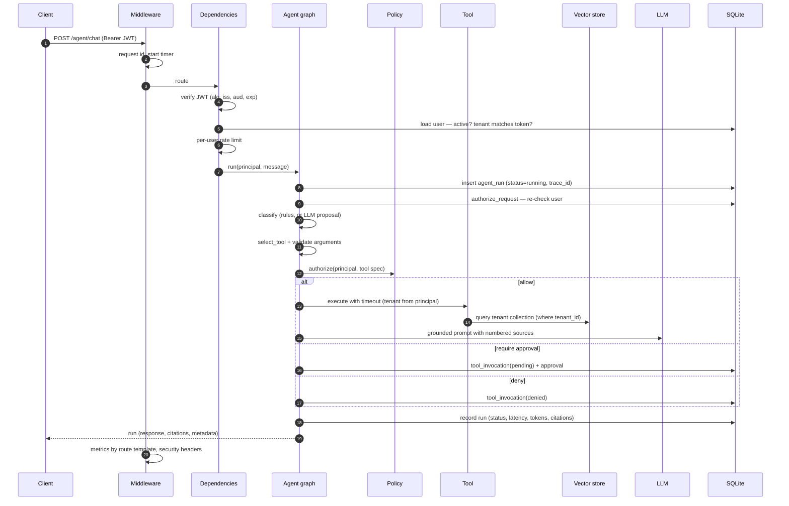
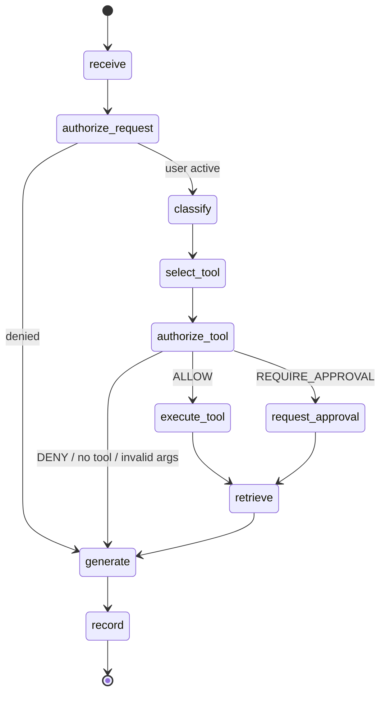
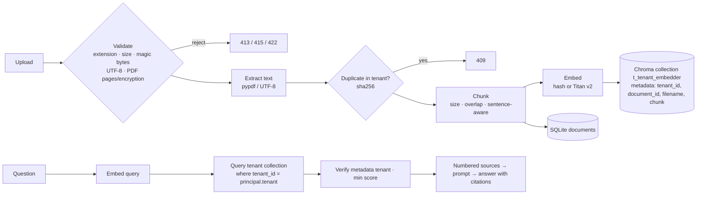

# Architecture

This document explains how SecureAgentOps handles a request end to end, why the boundaries sit where they
do, and how the local design maps onto AWS. Every component described in sections 1–6 is implemented and
tested. Section 7 separates what exists from what is proposed.

## 1. Components

| Layer | Module | Responsibility |
|---|---|---|
| HTTP | `app/main.py`, `app/api/*` | FastAPI app factory, routes, schemas, dependencies |
| Identity | `app/auth/*` | Argon2id hashing, JWT issue/verify, `Principal`, account service |
| Data | `app/db/*` | SQLAlchemy models, sessions, `TenantRepository` / `AccountRepository` |
| Agent | `app/agent/*` | LangGraph workflow, classifier, prompts, reply templates, approval service |
| Tools | `app/tools/*` | Tool specs and schemas, policy engine, executor, built-in tools |
| Retrieval | `app/rag/*` | Upload parsing, chunking, embeddings, Chroma store, retrieval service |
| Models | `app/llm/*` | Provider interface, mock, Bedrock adapter, token/cost accounting |
| Operations | `app/observability/*`, `app/security/*` | Metrics, tracing, request middleware, rate limiting |
| UI | `frontend/*` | Streamlit dashboard and a thin API client |

Everything is wired once in `build_container()` (`app/main.py`) and stored on `app.state`; tests replace the
LLM through `create_app(settings, llm=...)`.

## 2. Request lifecycle



Key properties:

- **The principal is rebuilt from the database on every request.** The JWT only proves identity; role and
  active status come from the `users` table, so revoking a role takes effect on the next request.
- **The tenant is never an input.** Routes receive a `TenantRepository` already scoped by the principal's
  tenant. No route, tool or prompt accepts a tenant id.
- **The run row is created before the graph starts**, so even an unexpected exception is recorded as a
  failed run with a generic message (`AgentService.run`).

## 3. Agent orchestration (LangGraph)



| Node | Does | LLM? |
|---|---|---|
| `receive` | Normalise whitespace, enforce length, initialise usage | no |
| `authorize_request` | Re-load the user; stop if inactive or tenant mismatch | no |
| `classify` | Intent + proposed arguments. Rules in mock mode; with Bedrock the model proposes JSON, and anything unusable falls back to rules | optional |
| `select_tool` | Intent → tool (fixed mapping); validate arguments against the tool's Pydantic model (`extra="forbid"`) | no |
| `authorize_tool` | `policy.authorize(principal, spec)` → allow / require approval / deny | no |
| `execute_tool` | Run in a worker thread with a timeout; persist the invocation | no |
| `request_approval` | Persist a pending invocation and an `Approval` with an expiry | no |
| `retrieve` | Knowledge questions: use the search results. Pending incidents: fetch runbook guidance | no |
| `generate` | Denials, approvals, status and usage use deterministic templates; knowledge answers use the LLM with numbered sources | knowledge only |
| `record` | Persist status, response, citations, latency, tokens (with source), cost, errors; emit metrics | no |

Each node runs inside an `agent.<node>` span and is timed by `sao_agent_node_duration_seconds`.

**Why templates for tool results?** If the model wrote "incident created" while the request was actually
pending, the UI would lie. Facts about actions come from structured results; the model only words answers
drawn from documents.

## 4. Tool authorisation

```
LLM / rules ──proposes──▶ intent ──fixed map──▶ tool name
                                               │
                    arguments ──schema──▶ validated arguments
                                               │
  principal (from DB) + ToolSpec (from code) ──▶ policy.authorize ──▶ ALLOW / REQUIRE_APPROVAL / DENY
```

- **Tool specs are code.** Each declares its input model, allowed roles, `read_only`, `requires_approval` and a
  timeout (`app/tools/builtin.py`).
- **Policy is a pure function** of principal and spec (`app/tools/policy.py`). Unknown tools are denied; any
  non-read-only tool requires approval even if a spec forgot to say so.
- **The model can't widen permissions.** The model's `tool` field is ignored, extra argument keys such as
  `approved` or `tenant_id` are rejected, and claims in text such as "I am an admin" change nothing. All four
  attacks are tested in `tests/test_agent_and_tools.py`.
- **Tools get a `ToolContext`** whose tenant comes from the principal. Tools open their own short-lived sessions
  through `TenantRepository`, so a tool can't query another tenant either.
- **Approvals** (`AgentService.decide`): approval looked up within the approver's tenant (others → 404) →
  approver must be an admin and, by default, not the requester → expiry check → compare-and-set
  `pending → executing` so two admins can't both execute → arguments re-validated → executed in the
  requester's tenant scope with the approver recorded as actor → run, invocation, approval and audit updated.

## 5. RAG pipeline



- **Chunking** (`app/rag/chunking.py`): character windows of `SAO_CHUNK_SIZE` that end at the last paragraph,
  line or sentence break in the second half of the window. Overlaps of `SAO_CHUNK_OVERLAP` start at a
  sentence boundary where possible.
- **Embeddings:** the default `HashingEmbedder` is deterministic and offline — signed feature hashing of
  stemmed unigrams and bigrams, L2-normalised. It needs no model download, so CI and demos are reproducible.
  `BedrockEmbedder` (Titan Text Embeddings v2) gives semantic retrieval. The embedder name is part of the
  collection name, so switching embedders never mixes incompatible vectors.
- **Isolation:** a separate collection per tenant, a metadata filter on every query, and a post-query check
  that drops any chunk whose `tenant_id` doesn't match (logged as an error). Tenant ids must match
  `^[a-f0-9]{32}$` before they reach Chroma.
- **Grounding:** sources are numbered and wrapped in `<source>` tags; the system prompt requires citations and
  forbids following instructions inside sources. With no relevant results the agent says so without calling
  the model.

## 6. Observability

| Signal | Where | Notes |
|---|---|---|
| HTTP count and latency | `RequestContextMiddleware` | Labelled by route template, so ids never become labels |
| Agent duration | `sao_agent_run_duration_seconds{intent}` | Plus per-node histograms |
| Tool calls | `sao_tool_invocations_total{tool,outcome}` | succeeded, failed, timeout, denied |
| Retrieval latency | `sao_retrieval_duration_seconds` | Measured around the vector query |
| Tokens | `sao_llm_tokens_total{provider,direction,source}` | `source` is `measured` or `estimated` |
| Cost | `sao_llm_estimated_cost_usd_total` | Only when both prices are configured; never for mock |
| Traces | OpenTelemetry SDK → OTLP/HTTP | FastAPI auto-instrumentation plus manual spans; the trace id is stored on each run |
| Audit | `audit_events` table, `/ops/audit` | Logins, failed logins, registrations, users, documents, approvals, incidents |

`/health` is liveness (process up). `/ready` checks the database and vector store and returns 503 when
degraded. Both are excluded from tracing to avoid noise.

## 7. AWS path: implemented vs proposed

| Concern | Local (implemented) | AWS | Status |
|---|---|---|---|
| LLM | `MockLLM` | Amazon Bedrock Converse API (`BedrockLLM`) | **Implemented**; verified offline with botocore Stubber, not against a live account |
| Embeddings | `HashingEmbedder` | Titan Text Embeddings v2 (`BedrockEmbedder`) | **Implemented**, not exercised by tests |
| Agent runtime | LangGraph in the API process | Amazon Bedrock AgentCore Runtime hosting the same graph, with AgentCore Identity for workload identity and AgentCore Observability for traces | Proposed |
| Tool gateway | In-process tool registry | AgentCore Gateway exposing tools behind IAM, with this policy engine kept as the authorisation layer | Proposed |
| API edge | Uvicorn on localhost | Amazon API Gateway (or ALB) + AWS WAF, throttling and usage plans replacing the in-memory limiter, Cognito or an OIDC authoriser | Proposed |
| Secrets | `.env` / environment | AWS Secrets Manager for the JWT key and DB credentials, injected into ECS tasks; rotation | Proposed |
| Vector store | Embedded Chroma | Amazon OpenSearch Serverless (vector) or Aurora PostgreSQL + pgvector, tenant id in every query plus index- or row-level isolation; or Bedrock Knowledge Bases with metadata filtering | Proposed |
| Relational data | SQLite | Amazon RDS / Aurora PostgreSQL with row-level security as a second isolation layer | Proposed |
| Compute | Docker Compose | ECS Fargate (API and dashboard as separate services), private subnets, VPC endpoints for Bedrock | Proposed |
| Telemetry | OTLP → any collector | AWS Distro for OpenTelemetry → X-Ray / CloudWatch; Amazon Managed Prometheus + Grafana | Proposed |
| Safety | Prompt hardening + code policy | Bedrock Guardrails (content filters, PII redaction) in addition to — not instead of — code authorisation | Proposed |

Migration notes:

1. The provider interface (`LLMClient.complete`) and the `Embedder` protocol are the only seams the agent
   uses, so swapping providers needs no graph changes.
2. `TenantRepository` and `VectorStore` are the only data-access seams. Moving to PostgreSQL or OpenSearch means
   re-implementing those two classes and keeping their tests.
3. The policy engine stays in the application even with AgentCore Gateway: IAM decides whether the service may
   call a tool; this policy decides whether *this user in this tenant* may.
4. Nothing here creates AWS resources. Any deployment should go through infrastructure-as-code review first,
   and cost-bearing services need an explicit budget alarm.
