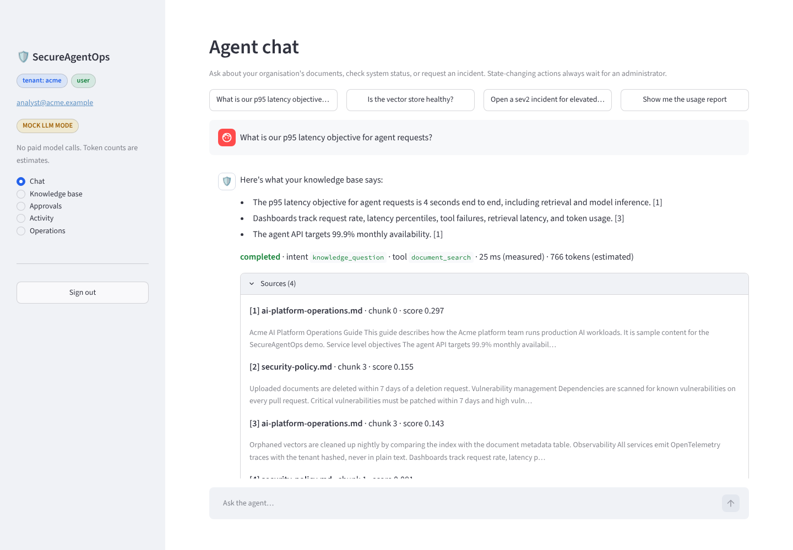
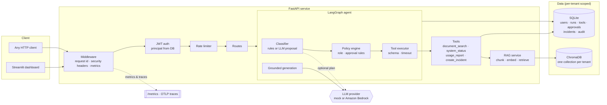
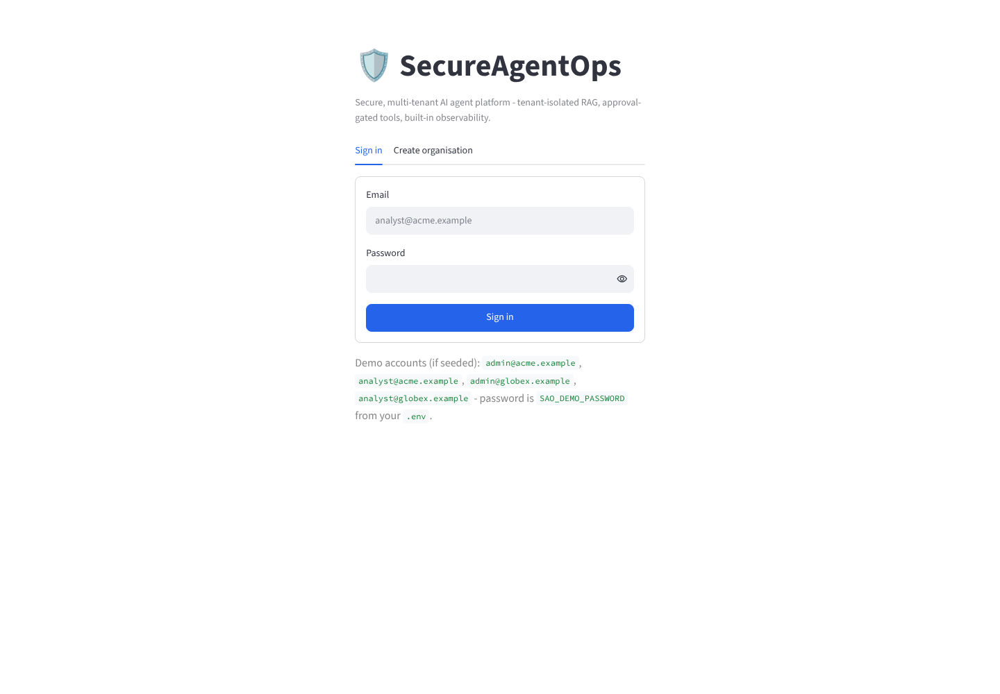
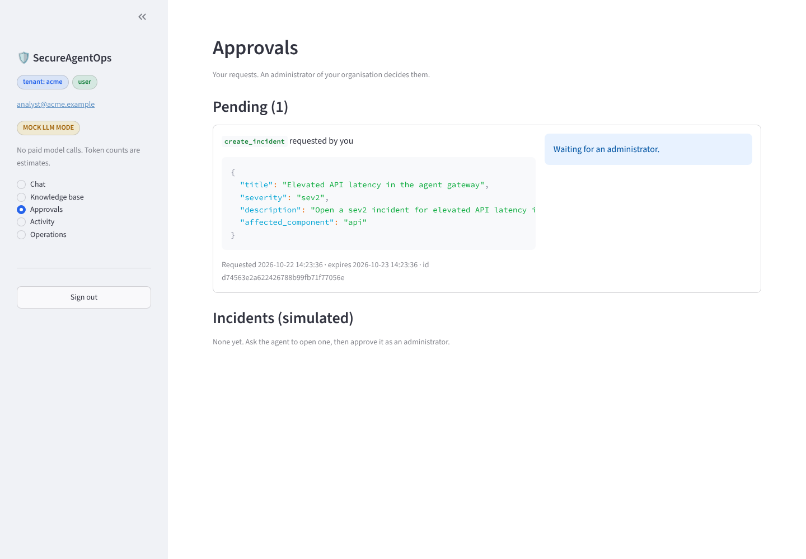
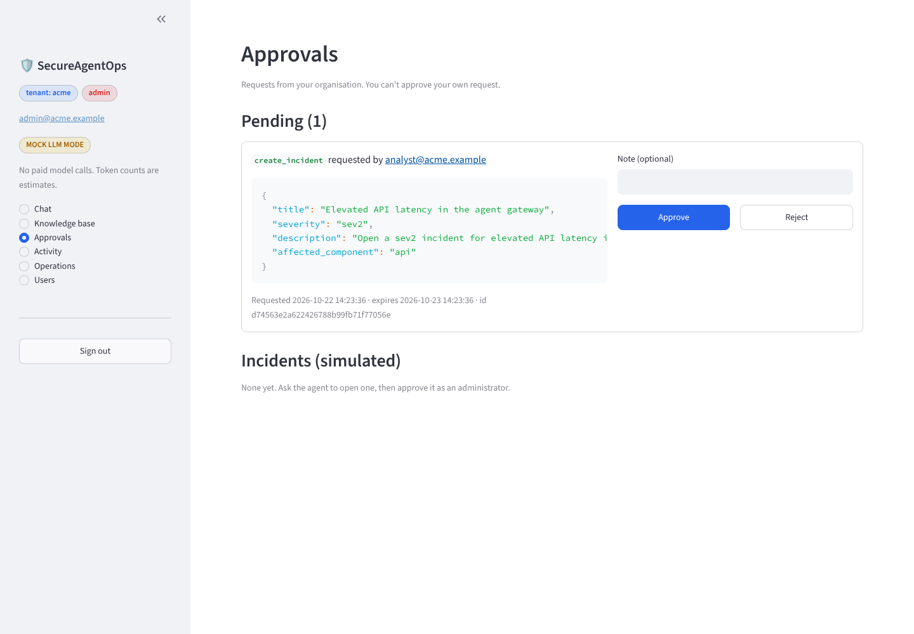
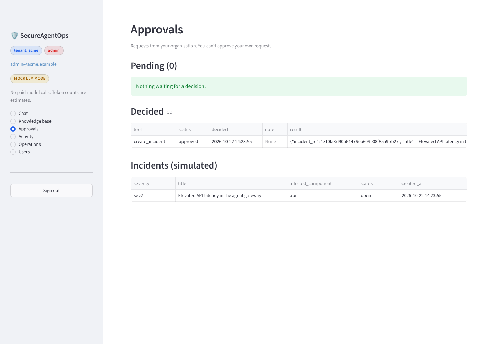
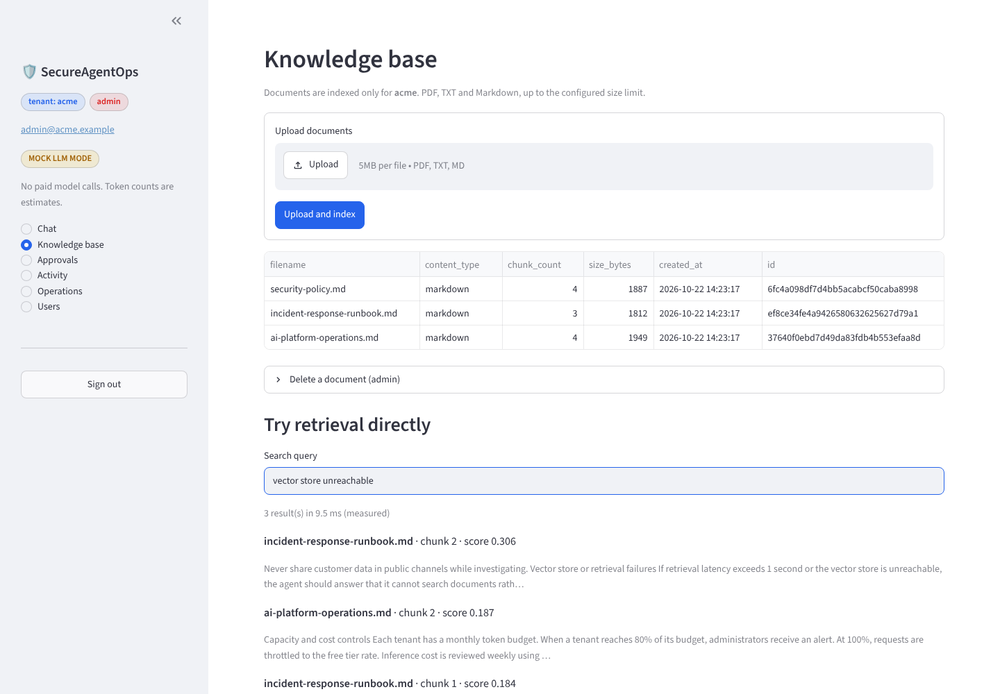
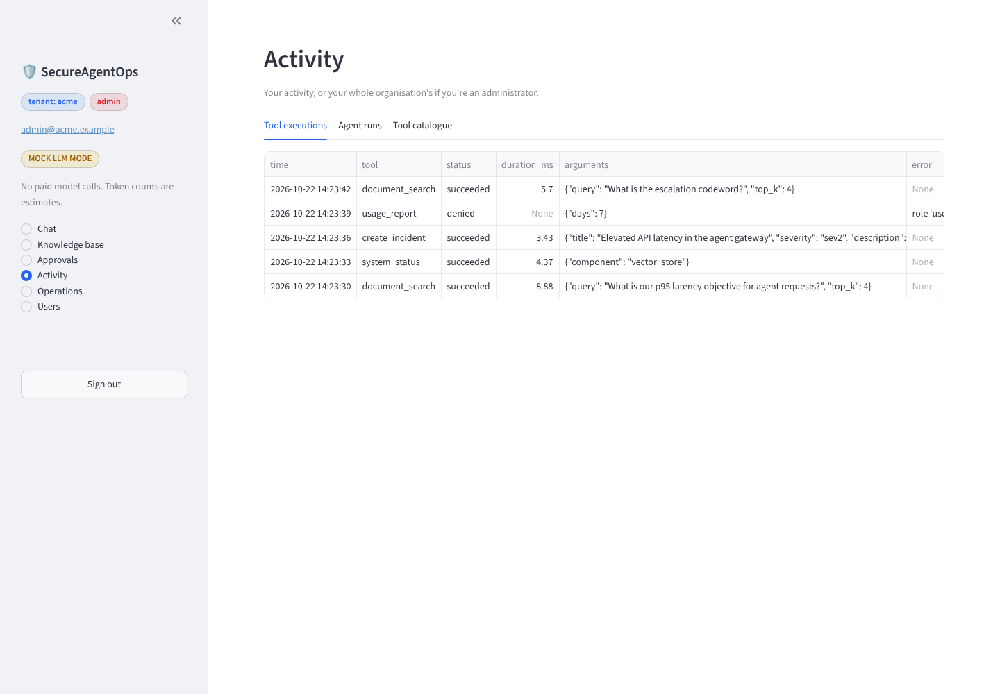
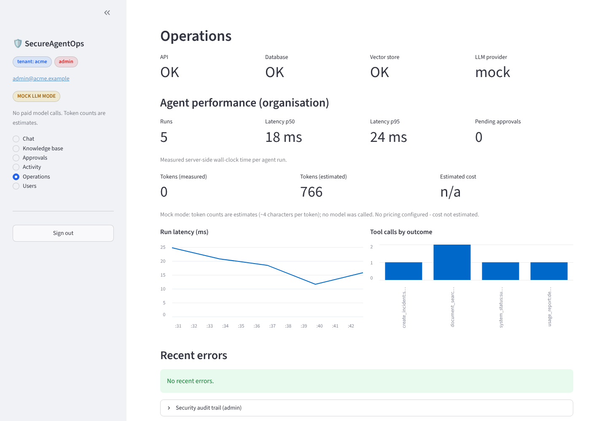

# SecureAgentOps — Enterprise AI Agent Platform

A secure, multi-tenant AI agent platform. Authenticated users chat with an agent that classifies each
request, picks a tool, checks permissions **in code**, retrieves tenant-scoped documents, and answers with
citations. Anything that changes state waits for a human administrator.

Runs fully offline in **mock mode** (no cloud account, no paid API calls). Amazon Bedrock is supported as an
optional provider.

> Portfolio project. It is built like a production service — tests, CI, containers, threat model — but it is
> not production-hardened. See [Known limitations](#known-limitations) and [SECURITY.md](SECURITY.md).



---

## The problem

Teams want LLM agents that can *do things* — search internal runbooks, check system health, open incidents.
In an enterprise that raises hard questions:

- **Isolation.** Customer A must never retrieve customer B's documents, even through a clever prompt.
- **Authority.** The model must not be able to grant itself permissions or skip an approval.
- **Accountability.** Every tool call, approval and login must be traceable.
- **Honesty about cost and performance.** Token counts and costs must be real measurements or clearly
  labelled estimates.

SecureAgentOps is a working reference for those boundaries.

## Features

| Area | What's implemented |
|---|---|
| **Auth** | Registration creates an organisation (tenant) + admin. Argon2id password hashing. HS256 JWTs with issuer/audience/expiry checks, pinned algorithm. Roles: `admin`, `user`. Role and active status are re-read from the database on every request. |
| **Tenant isolation** | `TenantRepository` adds `tenant_id` to every query. One Chroma collection per tenant *plus* metadata filtering *plus* post-query verification. Cross-tenant ids return 404. |
| **Agent** | LangGraph state machine: receive → authorize request → classify → select tool → authorize tool → execute / request approval → retrieve → generate → record. |
| **Tools** | `document_search`, `system_status` (live checks), `usage_report` (admin only), `create_incident` (simulated, approval required). Pydantic schemas with `extra="forbid"`, per-tool timeouts, contained failures. |
| **Human in the loop** | State-changing tools create an approval request. Only an admin of the same tenant can decide; not their own request; approvals expire; compare-and-set prevents double execution. |
| **RAG** | Upload PDF/TXT/Markdown → validate → extract → chunk (configurable size/overlap, sentence-aware) → embed → store. Answers cite numbered sources. Empty results and bad files are handled gracefully. |
| **LLM providers** | `mock` (deterministic, extractive, cited) and `bedrock` (Converse API). The model may *propose* a plan; policy decides. |
| **Observability** | OpenTelemetry spans for requests, every graph node, tools, retrieval and LLM calls (OTLP/HTTP export). Prometheus `/metrics`. Measured vs. estimated tokens labelled everywhere; cost only when pricing is configured. |
| **Security hardening** | Rate limiting (login, registration, per user), upload size/type/magic-byte checks, filename sanitising, safe error bodies, security headers, audit trail, non-root read-only containers. |
| **Dashboard** | Streamlit: login/registration, chat with sources, knowledge base, approvals, tool history, operations (latency, tokens, errors, health), audit trail, user management. |
| **DevSecOps** | Ruff (incl. flake8-bandit rules), pytest (97 tests, 95% line coverage), pip-audit against the lockfile, gitleaks, Docker build + container smoke test in GitHub Actions. |

## Technology

Python 3.12 · FastAPI · LangGraph · Pydantic v2 · SQLAlchemy 2 + SQLite · ChromaDB (embedded) · Streamlit ·
OpenTelemetry · prometheus-client · PyJWT · argon2-cffi · pypdf · boto3 (optional) · uv · Ruff · pytest ·
Docker / Compose · GitHub Actions

## Architecture



Request lifecycle, the agent graph, authorisation, the RAG pipeline, observability and the AWS roadmap are
explained in [ARCHITECTURE.md](ARCHITECTURE.md).

## Quick start

### Option A — Docker Compose (mock mode)

```bash
cp .env.example .env            # or: make env  (generates a random JWT secret and demo password)
docker compose up --build -d
```

- Dashboard: http://localhost:8501
- API docs: http://localhost:8000/docs
- Demo accounts: `admin@acme.example`, `analyst@acme.example`, `admin@globex.example`,
  `analyst@globex.example`. Password: the `SAO_DEMO_PASSWORD` value in `.env`.

Ports are bound to `127.0.0.1` only. Stop with `docker compose down` (data persists in the `sao-data` volume).

### Option B — local Python

Requires Python 3.12+ and [uv](https://docs.astral.sh/uv/).

```bash
make install        # uv sync --all-extras
make env            # create .env with generated secrets
make run-api        # terminal 1 -> http://localhost:8000 (seeds demo data on first start)
make run-ui         # terminal 2 -> http://localhost:8501
```

`make help` lists every target.

### Switching to Amazon Bedrock (optional, incurs AWS charges)

```bash
SAO_LLM_PROVIDER=bedrock
SAO_BEDROCK_MODEL_ID=amazon.nova-lite-v1:0       # any Converse-compatible model enabled in your account
SAO_AWS_REGION=us-east-1
SAO_PRICE_INPUT_PER_1K_TOKENS=...                 # optional, for cost estimates
SAO_PRICE_OUTPUT_PER_1K_TOKENS=...
```

Credentials come from the standard AWS chain (profile, SSO or IAM role) — never from `.env`. With Bedrock,
the model also proposes the intent and tool arguments (still subject to policy) and token counts come from
Bedrock's `usage` report, so they are labelled *measured*. Optional semantic embeddings:
`SAO_EMBEDDING_PROVIDER=bedrock` with `SAO_EMBEDDING_DIM=1024` (Titan Text Embeddings v2; re-index after
switching).

## Demo script (5 minutes)

1. **Sign in as `analyst@acme.example`.** Note the *tenant: acme* and *user* badges and the *MOCK LLM MODE* pill.
2. **Ask** "What is our p95 latency objective for agent requests?" → cited answer from
   `ai-platform-operations.md`; expand *Sources*. Latency is measured; tokens are labelled *estimated*.
3. **Ask** "Is the vector store healthy?" → `system_status` runs live checks (DB latency, chunk count).
4. **Ask** "Show me the usage report" → **denied**: `usage_report` is admin-only, and the policy is in code.
5. **Ask** "Open a sev2 incident for elevated API latency in the agent gateway" → **pending approval**, with
   relevant runbook guidance. Nothing is created yet.
6. **Ask** "What is the escalation codeword?" → no answer. The codeword exists only in Globex's documents.
7. **Sign in as `admin@acme.example`** → *Approvals* → **Approve**. The simulated incident appears; the
   original run is updated.
8. **Operations** → p50/p95 latency, measured vs. estimated tokens, tool outcomes, audit trail.
9. **Sign in as `analyst@globex.example`** and ask about the codeword → Globex gets *BLUE-HERON*.
10. `curl localhost:8000/metrics | grep sao_` → Prometheus metrics with no tenant ids in labels.

## API

Interactive OpenAPI docs at `/docs` (disabled when `SAO_ENVIRONMENT=production`). All endpoints except
`/health`, `/ready`, `/metrics`, `/auth/register` and `/auth/login` need `Authorization: Bearer <token>`.

| Method | Path | Who | Purpose |
|---|---|---|---|
| POST | `/auth/register` | public | Create an organisation and its first admin |
| POST | `/auth/login` | public | Exchange email + password for a JWT |
| GET | `/auth/me` | any | Current principal |
| GET / POST | `/auth/users` | admin | List / add users in your organisation |
| POST | `/agent/chat` | any | Run the agent on a message |
| GET | `/agent/runs`, `/agent/runs/{id}` | any | Runs (own; admins see the organisation's) |
| GET | `/agent/tool-invocations` | any | Tool execution history |
| GET | `/agent/tools` | any | Tool catalogue: schemas, roles, approval flags |
| GET | `/approvals?status=` | any | Approval requests (own; admins see all) |
| POST | `/approvals/{id}/approve`, `/reject` | admin | Decide an approval (not your own) |
| GET | `/incidents` | any | Simulated incidents |
| POST | `/documents` | any | Upload and index PDF/TXT/MD (multipart `file`) |
| GET | `/documents`, `/documents/search?q=` | any | List documents; direct retrieval without the LLM |
| DELETE | `/documents/{id}` | admin | Remove a document and its vectors |
| GET | `/ops/summary` | any | Latency percentiles, tokens, cost, errors |
| GET | `/ops/audit` | admin | Security audit trail |
| GET | `/health`, `/ready`, `/metrics` | public | Liveness, readiness, Prometheus metrics |

Errors always look like `{"error": {"code", "message", "request_id"}}`. Validation errors list fields but
never echo submitted values.

```bash
TOKEN=$(curl -s -X POST localhost:8000/auth/login -H 'content-type: application/json' \
  -d '{"email":"analyst@acme.example","password":"<SAO_DEMO_PASSWORD>"}' | jq -r .access_token)
curl -s -X POST localhost:8000/agent/chat -H "authorization: Bearer $TOKEN" \
  -H 'content-type: application/json' -d '{"message":"Who can approve state-changing tools?"}' | jq
curl -s -X POST localhost:8000/documents -H "authorization: Bearer $TOKEN" -F file=@notes.md
```

## Testing

```bash
make test      # 97 tests, offline, mock LLM, ~40 s
make cov       # with coverage (95% of app/; the untested Titan embedder counts against it)
make lint      # ruff check + format check
make audit     # pip-audit against uv.lock
```

| Suite | Covers |
|---|---|
| `test_auth.py` | Registration, Argon2 hashes, generic login errors, tampered/forged/`alg:none`/expired tokens, tenant-mismatched tokens, RBAC, immediate effect of role changes and deactivation |
| `test_tenant_isolation.py` | Documents, search, agent answers, runs, approvals, deletion and tool history across two tenants; repository and vector-store guards |
| `test_agent_and_tools.py` | Classification, grounded answers, live status, admin-only denial, the full approval lifecycle (approve, reject, self-approval, expiry, double decision), and a **scripted malicious LLM** that tries to skip approval, inject arguments, claim admin rights or swap tools |
| `test_rag.py` | Chunking, embeddings, stemming, PDF/TXT/MD upload, bad types, oversize, empty, duplicates, citations, deletion |
| `test_api_and_observability.py` | Health, readiness, metrics content and label hygiene, security headers, error format, no leaked internals, rate limits, honest summary labels, audit trail |
| `test_config_and_bedrock.py` | Production config guards, the Bedrock adapter against **botocore Stubber** responses (measured tokens, cost, sanitised errors), demo seeding |

LLM calls are never made in tests: the mock provider or a scripted fake is used, and Bedrock is exercised
through botocore's offline Stubber.

## Security design

- **Authorisation lives in code.** `app/tools/policy.py` decides from the database-backed principal and the
  static tool spec. The LLM only proposes an intent; the intent fixes the tool; arguments are validated
  against a strict schema; then policy runs. Tests prove a scripted malicious model can't get around it.
- **Tenant isolation in depth.** Tenant id comes from the verified token and is re-checked against the user
  record. Repositories can't be built without it. Vector data is separated by collection and filtered by
  metadata, and results are re-verified.
- **Human approval** for every state-changing tool, with separation of duties, expiry and race-safe execution.
- **Untrusted content** — user messages and retrieved documents — is wrapped and labelled in prompts and
  rendered as plain text in the UI.

Full threat model, controls, accepted dependency advisories and production gaps: [SECURITY.md](SECURITY.md).

## Observability

- **Traces:** spans for each HTTP request, `agent.run`, every graph node (`agent.classify`,
  `agent.execute_tool`, …), `policy.authorize`, `tool.<name>`, `rag.retrieve`, `rag.index` and
  `llm.generate`. Export with `SAO_OTEL_EXPORTER_OTLP_ENDPOINT` (verified against a local OTLP/HTTP sink) or
  `SAO_OTEL_CONSOLE_EXPORT=true`. Each agent run stores its trace id.
- **Metrics (`/metrics`):** `sao_http_requests_total`, `sao_http_request_duration_seconds`,
  `sao_agent_runs_total`, `sao_agent_run_duration_seconds`, `sao_agent_node_duration_seconds`,
  `sao_tool_invocations_total{outcome}`, `sao_tool_duration_seconds`, `sao_retrieval_duration_seconds`,
  `sao_llm_calls_total`, `sao_llm_tokens_total{source="measured|estimated"}`,
  `sao_llm_estimated_cost_usd_total`, `sao_rate_limited_total`, `sao_approvals_total`. Labels use route
  templates and never contain tenant or user ids.
- **Honesty rules:** latency is measured wall-clock time. Tokens are *measured* only when the provider reports
  them; otherwise *estimated* (~4 characters/token) and labelled as such. Cost is computed only when
  `SAO_PRICE_*` is set, never in mock mode, and always called an estimate.

## Screenshots

These were captured from the running application with Playwright (mock mode, seeded demo data).

| | |
|---|---|
|  Login |  Chat with cited sources |
|  A user's pending request |  Admin approval queue |
|  Approved → simulated incident |  Knowledge base and direct retrieval |
|  Tool execution history |  Operations dashboard |

**Re-capturing:** start the stack (`docker compose up -d` or `make run-api` + `make run-ui`), walk through the
[demo script](#demo-script-5-minutes) at 1440×1000, and save each view to `docs/screenshots/` with the same
file names. Use the demo tenants only — never screenshot real data.

## Project layout

```
app/
  api/            routes, request/response schemas, dependencies (auth, tenant scope, rate limits)
  agent/          LangGraph workflow, classifier, prompts, reply templates, approval service
  tools/          tool specs, policy engine, executor, built-in tools
  auth/           passwords (Argon2id), JWTs, principal, account service
  rag/            loaders, chunking, embeddings (hash / Titan), Chroma store, retrieval service
  llm/            provider interface, mock, Bedrock adapter, usage accounting
  db/             SQLAlchemy models, session, tenant-scoped repositories
  observability/  metrics, tracing, request middleware
  security/       rate limiter
  config.py  errors.py  demo.py  main.py
frontend/         Streamlit dashboard + API client
sample_data/      acme/ and globex/ knowledge bases (fictional)
tests/            pytest suites
scripts/          audit.sh, make_env.py
docs/             screenshots, deployment checklist
```

`app/llm/` and `app/security/` are separate packages (not under `agent/`) because tools and the classifier
both depend on them and they have no agent-specific logic.

## Known limitations

- **Single process.** Rate limits are in memory and Chroma runs embedded, so the API runs one worker.
  Scaling out needs Redis (or a gateway) for limits and a managed vector store.
- **SQLite** is fine for a demo, not for concurrent production writes. Use PostgreSQL.
- **Hash embeddings** match words (with light stemming), not meaning. Use Bedrock Titan or another embedding
  model for semantic retrieval.
- **Mock answers are extractive**, not generated prose. They prove grounding and citations, not language quality.
- **Bedrock is verified offline only** (botocore Stubber). It has not been run against a live AWS account in
  this repository.
- **Tool timeouts** return control to the request but can't kill a running Python thread; tools must bound
  their own work.
- **JWTs can't be revoked** before expiry (deactivation is enforced because users are re-read per request).
  No refresh tokens, MFA or SSO.
- **No malware scanning** of uploads and no per-tenant storage quotas.
- **Incidents are simulated** local records — nothing is paged.

## Future improvements

PostgreSQL with row-level security · Redis rate limiting · OIDC/SSO and MFA · refresh tokens and revocation ·
managed vector store (OpenSearch Serverless or Aurora pgvector) · Bedrock Guardrails · evaluation harness for
retrieval and answer quality · streaming responses · per-tenant token budgets · real incident integrations
(PagerDuty, Jira) behind the same approval flow · Terraform for the AWS deployment in
[ARCHITECTURE.md](ARCHITECTURE.md#aws-path-implemented-vs-proposed).

## Further reading

- [ARCHITECTURE.md](ARCHITECTURE.md) — how a request flows through the system, and the AWS path
- [SECURITY.md](SECURITY.md) — threat model, controls, limitations
- [docs/DEPLOYMENT_CHECKLIST.md](docs/DEPLOYMENT_CHECKLIST.md) — what to do before production
